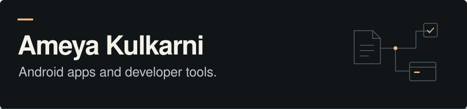

[Portfolio](https://ameyak.me/) · [Résumé](https://ameyak.me/assets/Ameya_Kulkarni_Resume.pdf) · [LinkedIn](https://www.linkedin.com/in/ameya-kulkarni-/) · [Email](mailto:ameyakulkarni2023@gmail.com)

I'm a **Master of Information student at the University of Toronto**, concentrating in Information Systems and Design. I build Android apps and developer tools, with a particular interest in system architecture: where state lives, how components communicate, and what happens when something fails.

## Currently building: ShowPapers

I'm co-developing **[ShowPapers](https://showpapers.app/)**, an Android app for scanning, organizing, and finding personal documents. It classifies scans into folders and lets users check extracted information against its source and correct it.

My work includes:

- **App architecture:** Kotlin and Jetpack Compose, with ViewModels and repositories separating UI state, document processing, and storage.
- **OCR and on-device AI:** SDK integration, model availability, and device eligibility handling.
- **The `.showpapers` format:** A protocol and validation rules for portable document collections, with import/export, Files and share sheet support, and a review step before importing.

**In development** · [Visit ShowPapers →](https://showpapers.app/)

## Selected projects

| Project | What I built | Engineering focus |
| :--- | :--- | :--- |
| **[Orbit Hub](https://github.com/amEya911/Orbit-Hub)** | An Antigravity sidebar for model quotas across accounts, with reset countdowns and data freshness indicators. | SQLite write-ahead log merging; schema-free Protocol Buffers decoding. |
| **[LLMetrics](https://github.com/amEya911/llmetrics)** | A VS Code extension for token use, estimated API costs, and session diagnostics across supported LLM integrations. | Node.js network instrumentation; a TypeScript SQLite reader with WAL support; six anti-pattern detectors. |
| **[NearChat](https://github.com/amEya911/NearChat)** | Offline group messaging between nearby Android devices over Bluetooth Classic. | RFCOMM handshake design; star relay topology; coroutine-scoped socket lifecycles. |
| **[Chattodo](https://chattodo.co/)** | An Android open alpha that turns chat messages into trackable tasks with a double tap, built through a technical mentorship project. | Compose performance; MVVM; Firestore listeners, caching, and ownership checks. |

Also built: **[Vanish](https://github.com/amEya911/BlinkChat)**, a live, temporary messaging project, and **[Two Cars](https://github.com/amEya911/TwoCars)**, an Android game with a custom Compose Canvas game loop.

## Tools I work with

| Area | Technologies |
| :--- | :--- |
| **Android** | Kotlin, Java, Jetpack Compose, Coroutines, ViewModels, MVVM / MVI |
| **Developer tools** | TypeScript, JavaScript, Node.js, VS Code extension APIs |
| **Data & integration** | SQL, SQLite, Firebase / Firestore, Protocol Buffers, Bluetooth RFCOMM, OCR and on-device AI SDKs |

## Background

- **University of Toronto** · Master of Information, Information Systems and Design · 2026–present.
- **SIES Graduate School of Technology, Mumbai** · B.E. in Electronics and Computer Science · 2021–2025 · CGPA: 8.73/10.
- **Edelweiss EAAA** · Business Transformation Intern · May–July 2026. Wrote operating procedures and a command centre proposal; supported vendor onboarding, UAT handoffs, and SAP stabilization.
- **Technical mentorship with Nirbhay Pherwani** · October 2025–March 2026. Built Chattodo while working on Android architecture, performance, Firebase access rules, and accessibility.

## How I approach a build

I start with a practical problem, then work through the data flow, state ownership, and failure cases. I like making those decisions visible: timestamps that distinguish cached data from fresh values, an import preview before documents enter a library, or cleanup that follows a connection's lifecycle.

Based in **Toronto, Canada**. Find project demos and more engineering detail at **[ameyak.me](https://ameyak.me/)**, or [get in touch](mailto:ameyakulkarni2023@gmail.com).
